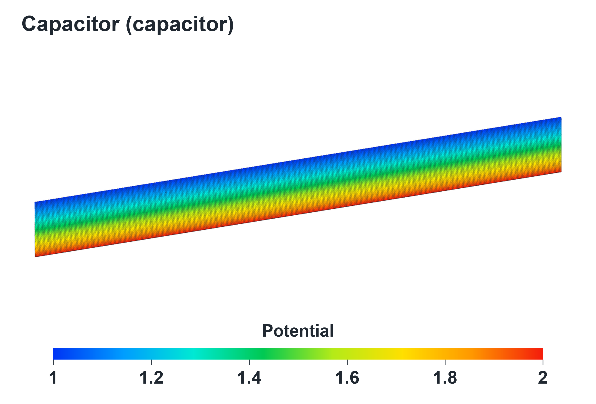

# Capacitor

[English](README.md) | [简体中文](README.zh-CN.md)

采用C3D20单元的三维同轴扇段，通过标量扩散类比势场。系数为8.8541878176e-12，内外表面的标量值分别为2和1。

## 模型参数

| 项目 | 数值 |
|---|---|
| 单元类型 | C3D20 |
| 网格维度 | 3维 |
| 细分参数 | 3 × 16 × 400 |
| 节点数 | 969,687 |
| 单元数 | 192,000 |
| 方程阶数n | 952,073 |
| 完整nnz | 47,134,131 |
| 每个完整应用的线性系统数 | 1 |

## 文件说明

- [加密输入](input/model.inp.gz)：gzip压缩的完整CalculiX模型，由运行工具解压。
- [参数文件](parameters.json)：网格、解法器配置与来源信息。
- [物理参数卡](physics-cards.inp)：供查看的材料、边界、载荷、步骤和输出卡片。
- [上游输入文件](source/)：CalculiX2.23验证案例，[来源](https://www.dhondt.de/ccx_2.23.test.tar.bz2)。

## 运行

按[构建说明](../../docs/BUILD-AND-RUN.zh-CN.md)完成编译与环境配置后，在`Calculix/`运行：

```bash
mkdir -p _work/runs
python3 tools/run_case.py capacitor \
  --binary _work/build/ccx_pangulu \
  --output _work/runs/capacitor
```

添加`--profile small`并选择另一个输出目录可运行上游网格。适配器采用L0排序和L2结构复用，图不变时更新系数并执行数值重分解。



物理含义见[案例介绍](../../docs/CASES.zh-CN.md)，检查与计时见[性能与验证](../../docs/RESULTS.zh-CN.md)。
