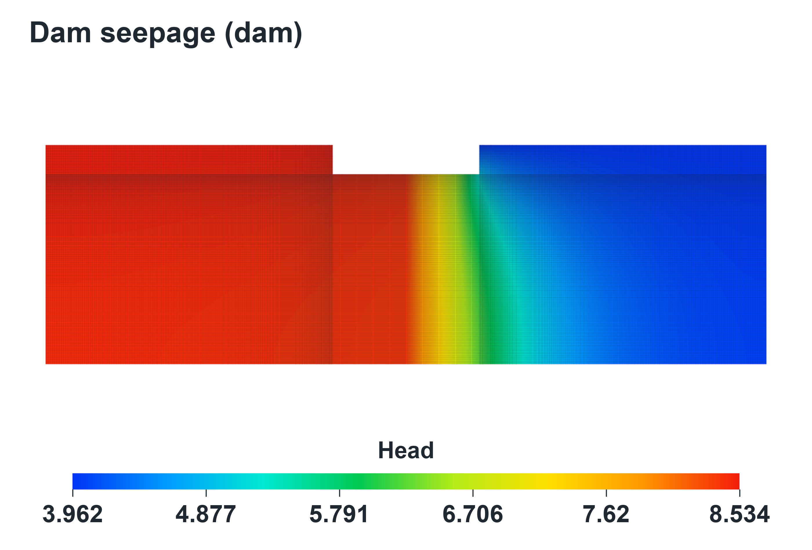
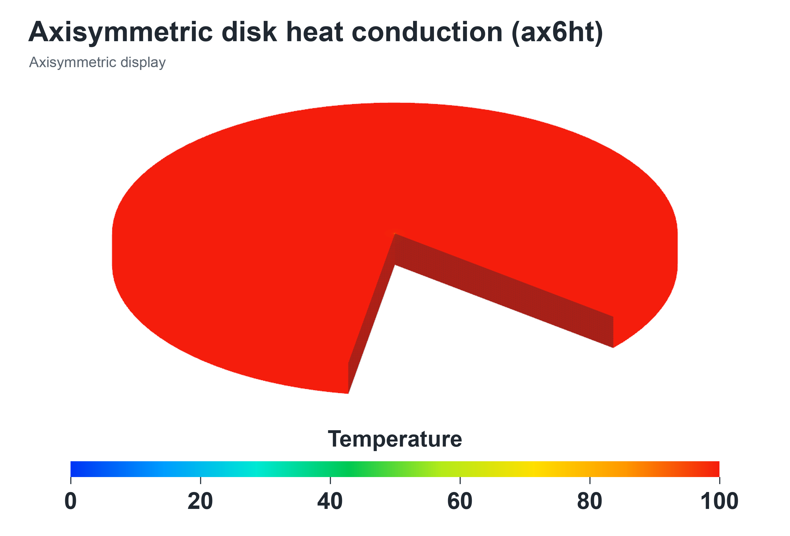
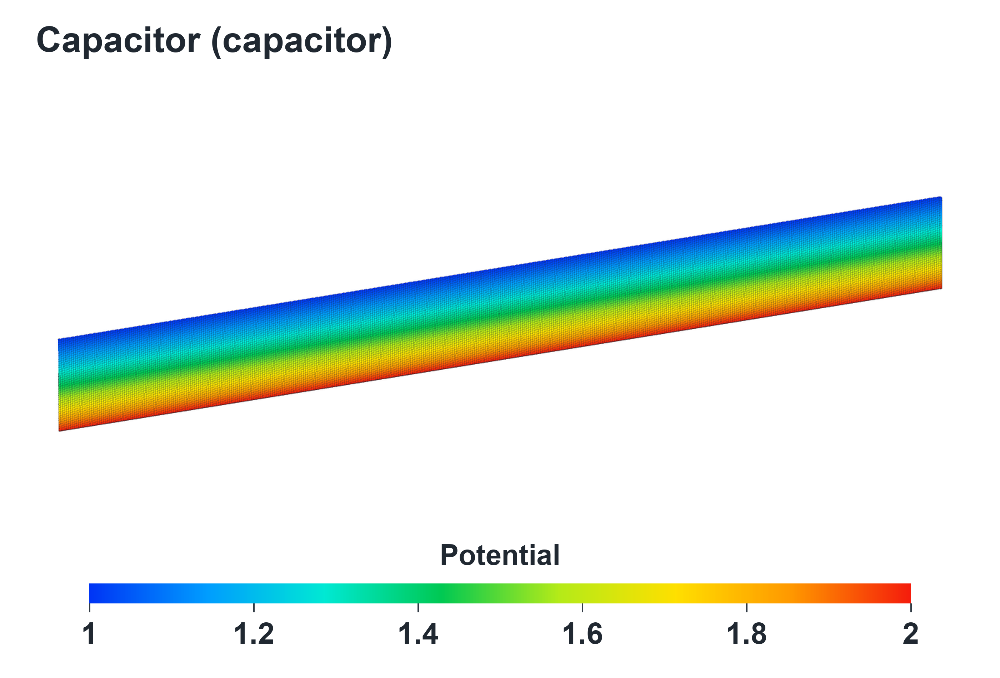
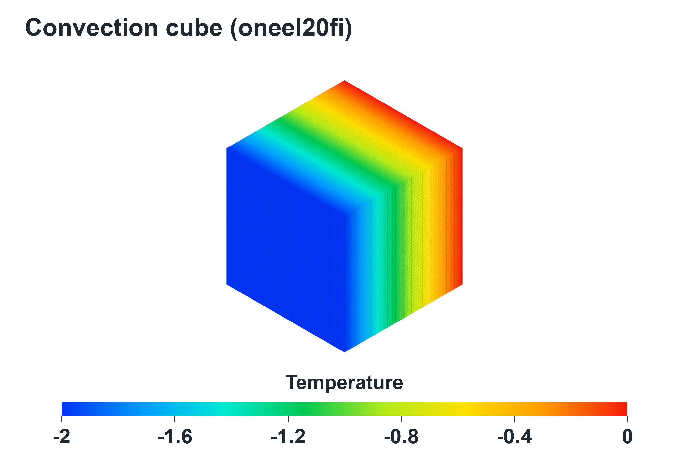
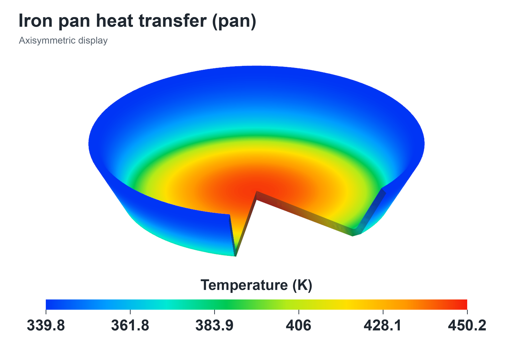

# 案例介绍

[English](CASES.md) | [简体中文](CASES.zh-CN.md) · [首页](../README.zh-CN.md)

前四例来自CalculiX2.23验证输入，Pan来自CalculiX社区的Launcher案例集。每例包含上游输入、加密模型、参数及结果图片。

下表列出处理约束后的实测方程阶数，完整存储nnz包含显式零元。

| 案例 | 单元 / 网格 | 细分参数 | 方程阶数n | 完整nnz | 参数 |
|---|---|---|---:|---:|---|
| Dam | CPS8 /二维平面 | 32 | 984,474 | 15,390,186 | [JSON](../cases/dam/parameters.json) |
| Ax6ht | CAX6 /二维轴对称 | 125 | 1,002,499 | 11,509,973 | [JSON](../cases/ax6ht/parameters.json) |
| Capacitor | C3D20 /三维 | 3×16×400 | 952,073 | 47,134,131 | [JSON](../cases/capacitor/parameters.json) |
| Oneel20fi | C3D20R /三维 | 44 | 352,440 | 19,849,804 | [JSON](../cases/oneel20fi/parameters.json) |
| Pan | CAX6 /二维轴对称 | 16 | 890,630 | 10,206,762 | [JSON](../cases/pan/parameters.json) |

## Dam：分层介质中的稳态扩散

该平面模型通过CalculiX导热形式求解地下水/标量扩散类比问题。模型包含两种正交各向异性材料，上下游边界分别施加8.5344和3.9624的标量值。细分过程保留CPS8父单元几何与材料区域。

验证内容包括完整标量场、通量场、边界值及整体平衡。

## Ax6ht：圆盘轴对称导热

二次CAX6三角形描述轴对称区域，导热系数为50，模型包含密度、比热及`STEP,NLGEOM`设置。节点1和46分别指定温度0和100。

这里采用点温度条件，约束节点附近的局部场会随加密变化，适合作为数值验证问题理解。验证内容包括完整温度/热流输出、点约束及整体平衡。

## Capacitor：同轴扇段的标量势场

该三维二次六面体模型描述同轴表面之间的有限角度扇段，利用导热标量扩散形式类比静电势问题。系数为8.8541878176e-12，内外表面分别指定2和1；温度输出在这里表示电势类比标量。

验证比较完整标量/通量场、边界值、平衡、对数径向解析分布及截面通量。比较容差考虑了二次扇段的几何近似。

## Oneel20fi：带对流边界的立方体

单位立方体采用C3D20R单元加密。导热系数为50，一面固定温度0，对面向环境温度−12、换热系数10的介质散热。步骤的时间增量和结束时间均为1。

稳态解析解为T=−2x、热流为(100,0,0)，可对全部输出节点进行检查。提供的模型包含352,440阶方程。

## Pan：铁锅加热与散热

锅体采用轴对称剖面，导热系数为50，底部通量为31500。空气侧和食物侧的换热系数分别为10和150，环境温度均为293.15。细分过程将边界条件映射到对应子面。

验证检查完整温度与热流场，并按完整旋转体的2πr权重计算对流热平衡。CalculiX原生展开扇区的体积单独记录。图中显示稳态场。

## 输入与运行

每例提供`source/`、`input/model.inp.gz`、`parameters.json`和`physics-cards.inp`，运行工具自动解压完整模型。`physics-cards.inp`用于查看材料、载荷、边界及步骤控制，实际运行使用完整模型。

五例均使用一个稳态增量。Capacitor有一次主线性系统调用，其余四例各两次。命令见[构建与运行](BUILD-AND-RUN.zh-CN.md)，性能及数值检查见[性能与验证](RESULTS.zh-CN.md)。
