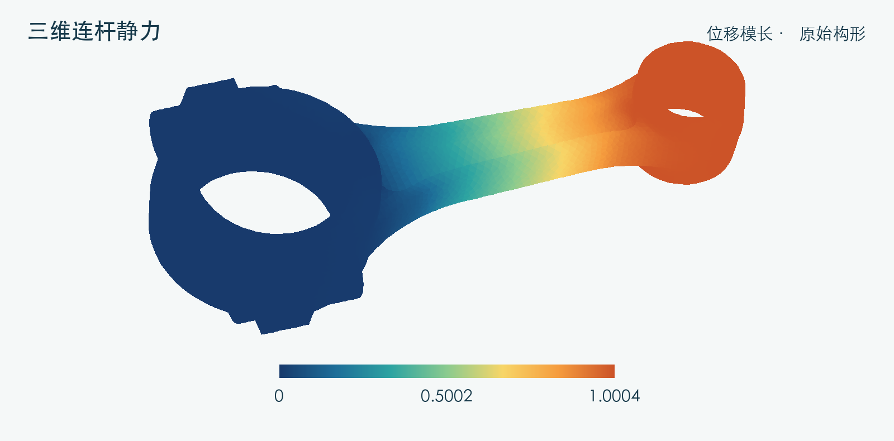

# 三维连杆静力 · 3D connecting rod

大端 FIX 组三个位移分量固定，小端 DISP 组第二方向的位移给定为 1。 All three displacements are fixed in FIX. The second displacement component in DISP is prescribed as 1.

| 节点 / Nodes | 单元 / Elements | 方程 / Equations | 求解次数 / Solves |
|---:|---:|---:|---:|
| 333,340 | 226,614 TET10 | 1,000,020 | 1 |



从项目根目录运行。Run from the package root after following the [build guide](../../docs/BUILD.md).

```bash
python3 scripts/run.py conrod runs/conrod --fistr1 build/frontistr/fistr1/fistr1
```

最终节点场位于 `runs/conrod/fstrRES/STEP1/conrod.res.0.1`。The [model manifest](model.json) identifies the exact decompressed mesh and reference field norms.
