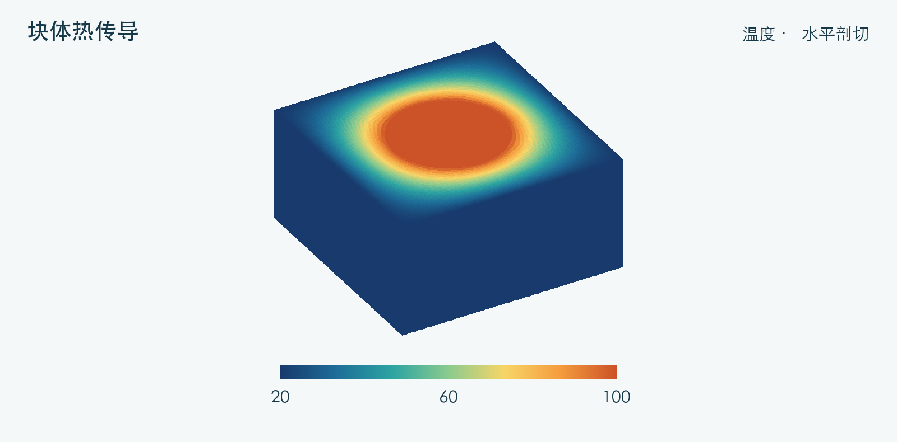

# 块体热传导 · Heat conduction in a block

中心 FTMPC 组温度为 100，四组侧面温度为 20。导热系数随温度更新。 FTMPC is held at 100 and four groups of side nodes at 20. Conductivity varies with temperature.

| 节点 / Nodes | 单元 / Elements | 方程 / Equations | 求解次数 / Solves |
|---:|---:|---:|---:|
| 914,550 | 868,320 HEX8 | 914,550 | 6 |



从项目根目录运行。Run from the package root after following the [build guide](../../docs/BUILD.md).

```bash
python3 scripts/run.py heat runs/heat --fistr1 build/frontistr/fistr1/fistr1
```

最终节点场位于 `runs/heat/block.res.0.1`。The [model manifest](model.json) identifies the exact decompressed mesh and reference field norms.
