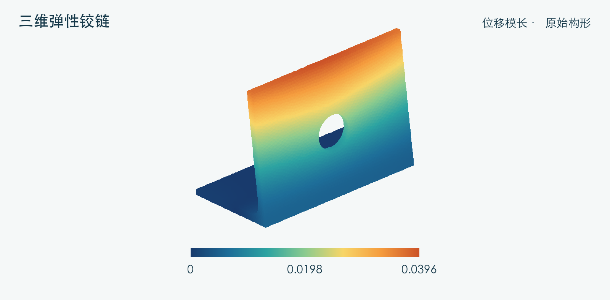

# 三维弹性铰链 · 3D elastic hinge

BND0 和 BND1 的三个方向均固定。保留原 CL0 载荷节点，在第一坐标方向施加节点载荷 0.01。 Both BND0 and BND1 are fixed in all directions. The original CL0 nodes carry a concentrated load of 0.01 in direction 1.

| 节点 / Nodes | 单元 / Elements | 方程 / Equations | 求解次数 / Solves |
|---:|---:|---:|---:|
| 333,340 | 227,819 TET10 | 1,000,020 | 1 |



从项目根目录运行。Run from the package root after following the [build guide](../../docs/BUILD.md).

```bash
python3 scripts/run.py hinge runs/hinge --fistr1 build/frontistr/fistr1/fistr1
```

最终节点场位于 `runs/hinge/hinge.res.0.1`。The [model manifest](model.json) identifies the exact decompressed mesh and reference field norms.
